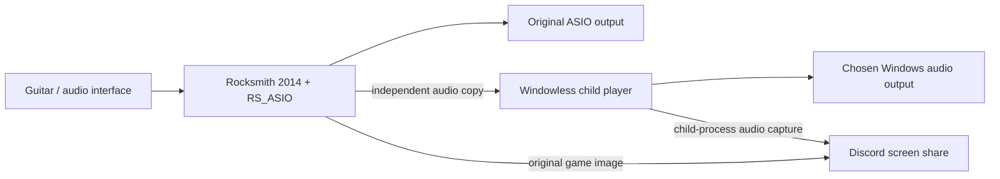

# Rocksmith Discord Bridge

**Share Rocksmith 2014 directly in Discord, with its ASIO audio, while keeping the original game image.**

[Português brasileiro](README.pt-BR.md) · [Downloads / Releases](https://github.com/erickyfigueiredo/RocksmithDiscordBridge/releases) · [Build status](https://github.com/erickyfigueiredo/RocksmithDiscordBridge/actions)

RS_ASIO normally bypasses the Windows audio path used by Discord. This mod copies the game's final output to a windowless audio player launched **as a child of Rocksmith**. Discord documents capture of the shared process and its children, so you can share **Rocksmith 2014 itself**, with sound. Video never goes through the Python player: the original resolution and Discord's normal capture controls remain available.



## Status and requirements

Version 0.1.0 is an **experimental Windows preview**. End-to-end Discord streaming has been confirmed on one Windows setup. The app lets each user select their output and preserves their existing ASIO configuration; wider hardware compatibility still needs testing.

- Windows 10/11 x64 and the Discord desktop app.
- Rocksmith 2014 Remastered, already working with **RS_ASIO 0.7.4** and a configured ASIO driver. This is an add-on for an existing RS_ASIO setup.
- An available stereo Windows WASAPI output for the copied audio.
- The ZIP from a Release includes Python and its dependencies. End users do not need Python, Node, OBS or Voicemeeter.

The copy uses a requested 60 ms playback buffer. If you listen through this copy, it may introduce noticeable playing latency; total latency has not been measured. The original ASIO path does not wait for the player. If you already monitor your interface directly, choose a separate output for the streaming copy to avoid hearing the game twice.

## Install and use

1. Download `RocksmithDiscordBridge-Windows-x64.zip` from **Releases**. The GitHub “Source code” ZIP does not contain the built app.
2. Extract the **entire** ZIP to a permanent, user-writable folder, such as Documents. Do not move it after installation.
3. Close Rocksmith. Run `Instalar.cmd`. It finds Steam libraries automatically or asks for the game's folder, then lets you choose your audio output. If writing to the game's directory is denied, run the installer as administrator.
4. Open Rocksmith normally through Steam. The mod starts the windowless player automatically.
5. In Discord, share **Rocksmith 2014**, with sound enabled. Choose your desired resolution and frame rate in Discord. Do not share the diagnostic bridge window.

The installer replaces `RS_ASIO.dll` and writes `RSBridgePlayer.txt`. It backs up the existing DLL and configuration and **preserves your ASIO input/output channels, buffers and video settings**. It does not install drivers or include any game files. Releases are currently unsigned.

For a different Steam library:

```powershell
powershell -NoProfile -ExecutionPolicy Bypass -File .\Install.ps1 -GameDirectory 'D:\SteamLibrary\steamapps\common\Rocksmith2014'
```

Use `Configurar-audio.cmd` with the game closed to change the selected Windows output. Start the game from Steam after closing an elevated installer; do not start Steam as administrator just for this mod.

## Restore

Close the game and restore the backup printed by the installer:

```powershell
powershell -NoProfile -ExecutionPolicy Bypass -File .\Restore.ps1 -BackupDirectory '.\backups\YOUR-BACKUP-FOLDER'
```

This restores the previous DLL/configuration and restores or removes the launcher configuration as appropriate. Keep the backup until you have verified your setup.

## Troubleshooting and limits

- **No copied audio:** check the chosen device with `Configurar-audio.cmd`, then reopen the game. The player must remain at the path saved during installation. Re-run the installer after moving the package.
- **Device already in use:** a device opened exclusively by ASIO may not also be available to WASAPI. Choose another output or use the interface's direct monitoring for playing.
- **Audio doubled:** stop any manually opened bridge and avoid monitoring the same game through both the interface and the copied output.
- **Stream paused after Alt+Tab:** share the original game. A game that minimizes or stops rendering may stop producing video/audio; keep it visible while playing, or use its windowed mode.
- **Low viewer quality:** video comes directly from the game. Received quality still depends on Discord's selected resolution/frame rate, account features, connection and encoding.
- Local diagnostics are in `player/diagnostics.json` and `player/bridge.log`. They are not uploaded by the app.
- Stereo, 48 kHz PCM16/24/32 and float32 are supported by the tap. Other formats are rejected.
- This is a community mod, with no Ubisoft or Discord affiliation. Compatibility with other RS_ASIO patches is not guaranteed.

See [CONTRIBUTING.md](CONTRIBUTING.md) for build/test instructions, architecture and useful bug-report details.

See [PRIVACY.md](PRIVACY.md) for local data and the contents of the source repository and release packages.

## Credits and licenses

New code: [MIT](LICENSE). Based on [RS_ASIO](https://github.com/mdias/rs_asio), copyright Micael Dias, also MIT. Bundled components and license texts are described in [THIRD_PARTY_NOTICES.md](THIRD_PARTY_NOTICES.md).

Technical reference: [Discord's description of process and child-process audio capture](https://discord.com/blog/how-it-all-goes-live-an-overview-of-discords-streaming-technology).
